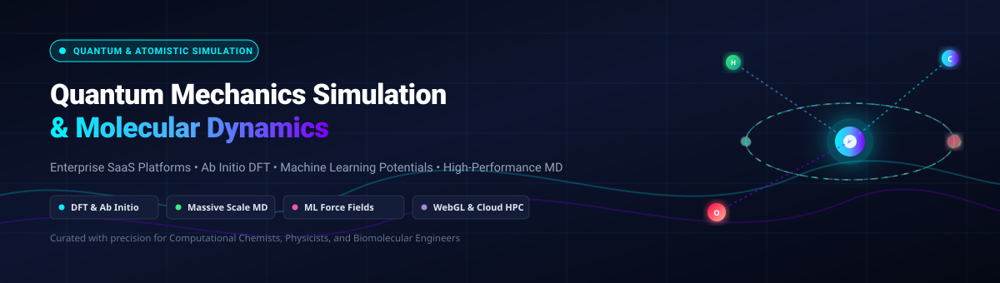

# Awesome Quantum Mechanics Simulation & Molecular Dynamics ⚛️

<p align="center">
  
</p>

<p align="center">
  <a href="https://github.com/ishandutta2007/Awesome-Awesome-Awesome"></a><a href="https://discord.gg/jc4xtF58Ve"></a>
  <a href="https://github.com/ishandutta2007/Awesome-Awesome-Awesome"></a>
  <a href="https://github.com/ishandutta2007/Awesome-Quantum-Mechanics-Simulation-Molecular-Dynamics"></a>
  <a href="https://github.com/ishandutta2007/Awesome-Quantum-Mechanics-Simulation-Molecular-Dynamics"></a>
  <a href="https://github.com/ishandutta2007/Awesome-Quantum-Mechanics-Simulation-Molecular-Dynamics/blob/main/README.md#how-to-contribute"></a>
  <a href="https://github.com/ishandutta2007"></a>
</p>

> 🔬 A curated directory and benchmark of industry-leading **Quantum Mechanics Simulation Packages**, **Density Functional Theory (DFT) Solvers**, **Ab Initio Quantum Chemistry Suites**, **Massively Parallel Molecular Dynamics (MD) Engines**, **Machine-Learned Equivariant Interatomic Potentials (MLIP)**, and **Interactive 3D WebGL Molecular Viewers** — spanning enterprise SaaS cloud platforms and state-of-the-art open-source repositories.

---

## 📑 Table of Contents

- [🌐 Sector Overview & Market Dynamics](#-sector-overview--market-dynamics)
- [☁️ SaaS & Hosted Simulation Platforms](#️-saas--hosted-simulation-platforms)
- [💻 Open-Source Quantum & Molecular Dynamics Frameworks](#-open-source-quantum--molecular-dynamics-frameworks)
- [🏗️ Architectural Paradigms & Modern Computational Chemistry Stacks](#️-architectural-paradigms--modern-computational-chemistry-stacks)
- [🤝 How to Contribute](#-how-to-contribute)
- [💖 Support](#-support)
- [⭐ Star History](#-star-history)
- [⚠️ Disclaimer](#️-disclaimer)

---

## 🌐 Sector Overview & Market Dynamics

The global quantum chemistry, atomistic modeling, and molecular dynamics simulation software market is valued at approximately **$3.6 Billion to $4.2 Billion** in 2025 and is projected to surpass **$9.5 Billion to $11.0 Billion by 2032**, exhibiting a robust Compound Annual Growth Rate (CAGR) of ~14.5–16.2%. 📈

The sector exhibits a **bifurcated, moderately concentrated structure** with distinct operational dynamics:
* 🏢 **High Concentration at the Enterprise Core**: Traditional, validated electronic structure solvers and patent-protected drug discovery suites (such as Dassault Systèmes BIOVIA, Schrödinger, and Gaussian) command deep defensibility across commercial pharma and advanced aerospace materials, operating with significant platform stickiness.
* 🧩 **Rapidly Fragmenting Open-Source & AI Frontier**: The rapid advent of foundation machine-learned interatomic potentials (e.g., MACE, DeePMD, NequIP, FairChem) and cloud-native simulation platforms (e.g., Rescale, Mat3ra, Materials Square) is breaking historic speed-versus-accuracy trade-offs. This layer is highly collaborative, dynamic, and distributed among specialized academic consortia, AI research labs, and open-source ecosystems.

---

## ☁️ SaaS & Hosted Simulation Platforms

Enterprise cloud platforms deliver preconfigured high-performance computing (HPC) workflows, elastic GPU clusters, collaborative WebGL visualization, and enterprise compliance.

The table below is sorted by **Company Size / Valuation / Market Cap** in descending order: 📊

| Platform | Company Size (Valuation / Market Cap / Revenue) | Starting Tier Pricing | Free Tier / Trial Limits | Description & Capabilities |
| :--- | :--- | :--- | :--- | :--- |
| **[BIOVIA Materials Studio (Dassault Systèmes)](https://www.3ds.com/products/biovia/materials-studio)** | ~$48.5 Billion (Dassault Systèmes Market Cap) | $12,500/year (base academic license) or $38,000/year (commercial team tier) | 14-day evaluation trial upon verified institutional/corporate qualification | Multi-scale atomistic and mesoscale materials modeling suite for polymers, catalysis, crystal engineering, and DFT property screening. |
| **[VASP Cloud on Rescale](https://www.rescale.com/)** | ~$1.2 Billion (Valuation) | $0.15/core-hour compute surcharge + BYOL (or $1,500/month Enterprise platform seat) | 14-day free trial with $200 in free HPC compute credits | Elastic cloud HPC orchestration engine pre-configured with MPI-optimized VASP, plane-wave DFT containers, and hardware acceleration. |
| **[Schrödinger Materials Science Suite & LiveDesign](https://www.schrodinger.com/platform/products/materials-science-suite/)** | ~$1.1 Billion (Market Cap) | $10,000/year (academic starter tier) or $45,000/year (commercial enterprise starting tier) | 30-day limited trial on request with valid corporate/academic email | Industry-leading computational chemistry, electronic structure, machine-learned property prediction, and collaborative molecular design. |
| **[Nanome Cloud](https://nanome.ai/)** | ~$28 Million (Estimated Valuation) | $199/user/month (Professional tier billed annually) or $499/user/month (Enterprise tier) | 14-day full-feature trial for VR/cloud collaborative molecular exploration | Spatial computing and cloud platform for immersive, real-time multi-user 3D molecular modeling, protein-ligand docking, and cryo-EM analysis. |
| **[Mat3ra (formerly Exabyte.io)](https://mat3ra.com/)** | ~$18 Million (Estimated Valuation) | $49/month (Developer tier) or $399/month (Team tier) | Free forever plan with 10 compute core-hours/month and 5 GB cloud storage | Web-based digital lab offering automated REST APIs and GUI workflows for Quantum ESPRESSO, VASP, and LAMMPS calculations. |
| **[Materials Square](https://www.materialssquare.com/)** | ~$12 Million (Estimated Valuation) | $0.08/core-hour (pay-as-you-go) or $299/month (Lab subscription tier) | Free forever plan with 100 free Welcome simulation points and 1 GB storage | Cloud materials simulation environment enabling browser-based Quantum ESPRESSO, LAMMPS, and OpenMX execution with zero CLI setup. |
| **[Gaussian Cloud / WebMO](https://www.webmo.net/)** | ~$10 Million (Estimated Valuation) | $600 one-time license (WebMO Pro) + Gaussian BYOL starting at $4,500 (academic) | WebMO Free forever edition with 3 active concurrent computational jobs | Standard electronic structure interface for setting up and visualizing DFT, CCSD(T), and reaction mechanism calculations. |
| **[Q-Chem Cloud & IQmol](https://www.q-chem.com/)** | ~$8 Million (Estimated Valuation) | $2,495 one-time workstation license (academic) or $7,500 (commercial starting tier) | 60-day fully functional trial license for workstations and clusters | Comprehensive ab initio quantum chemistry software specializing in excited-state TD-DFT, energy decomposition analysis, and solvation. |
| **[ChemDoodle Web Components & Cloud](https://www.chemdoodle.com/)** | ~$5 Million (Estimated Valuation) | $19/user/month (ChemDoodle 3D) or $1,200/year (Site/Web API integration) | 14-day free trial of ChemDoodle 3D desktop/cloud with save/export capabilities | Lightweight HTML5/WebGL molecular modeling toolkit and chemistry sketching API designed for web and desktop integration. |
| **[MolView](https://molview.org/)** | Non-profit / Open Community Initiative | Free / Ad-supported open community web app | Free forever with unlimited client-side WebGL molecular viewing and PubChem lookup | Intuitive web-based 2D chemical sketcher and 3D molecular structural visualizer connected to Crystallography Open Database and RCSB PDB. |

---

## 💻 Open-Source Quantum & Molecular Dynamics Frameworks

Curated open-source software libraries, atomistic engines, and ab initio solvers.

The table below is sorted by **GitHub Stars** in descending order: 🌟

| Repository | GitHub Stars | Core Focus & Capabilities | Tech Stack |
| :--- | :--- | :--- | :--- |
| **[RDKit](https://github.com/rdkit/rdkit)** | [](https://github.com/rdkit/rdkit/stargazers) | Premier cheminformatics toolkit: 2D/3D conformer generation, UFF/MMFF94 force-field minimization, fingerprints, and molecular descriptors. | C++, Python |
| **[LAMMPS](https://github.com/lammps/lammps)** | [](https://github.com/lammps/lammps/stargazers) | Massive parallel molecular dynamics simulator for materials, soft matter, mesoscale, and atomistic systems with extensive ML-force-field bridges. | C++, MPI, OpenMP, CUDA |
| **[FAIR-Chem](https://github.com/facebookresearch/fairchem)** | [](https://github.com/facebookresearch/fairchem/stargazers) | Meta AI library of deep learning models for chemical catalysis, inorganic crystal discovery, and the Open Catalyst Project. | Python, PyTorch |
| **[DeePMD-kit](https://github.com/deepmodeling/deepmd-kit)** | [](https://github.com/deepmodeling/deepmd-kit/stargazers) | Deep learning package for many-body potential energy representation, enabling ab initio-level accuracy at empirical molecular dynamics scale. | C++, Python, TensorFlow, PyTorch, CUDA |
| **[OpenMM](https://github.com/openmm/openmm)** | [](https://github.com/openmm/openmm/stargazers) | High-performance GPU-accelerated molecular simulation engine with customizable pythonic force field pipelines and enhanced sampling APIs. | C++, Python, CUDA, OpenCL |
| **[Pymatgen](https://github.com/materialsproject/pymatgen)** | [](https://github.com/materialsproject/pymatgen/stargazers) | Python Materials Genomics library powering the Materials Project: crystal structures, phase diagrams, band structures, and DFT parsers. | Python, Cython |
| **[PySCF](https://github.com/pyscf/pyscf)** | [](https://github.com/pyscf/pyscf/stargazers) | Modular electronic structure platform supporting Hartree-Fock, DFT, MP2, CASSCF, coupled cluster (CCSD(T)), and periodic boundary calculations. | Python, C |
| **[MDAnalysis](https://github.com/MDAnalysis/mdanalysis)** | [](https://github.com/MDAnalysis/mdanalysis/stargazers) | Object-oriented Python library to parse, analyze, and manipulate trajectories from GROMACS, LAMMPS, CHARMM, AMBER, and NAMD. | Python, Cython, C |
| **[MACE](https://github.com/ACEsuit/mace)** | [](https://github.com/ACEsuit/mace/stargazers) | Equivariant message-passing neural network interatomic potentials delivering near-DFT precision for molecules, liquids, and materials. | Python, PyTorch |
| **[Open Babel](https://github.com/openbabel/openbabel)** | [](https://github.com/openbabel/openbabel/stargazers) | Universal chemical toolbox designed to translate inter-atomic coordinates, force fields, and chemical data formats across 100+ specifications. | C++, Python |
| **[CP2K](https://github.com/cp2k/cp2k)** | [](https://github.com/cp2k/cp2k/stargazers) | Solid-state physics and quantum chemistry engine specialized in mixed Gaussian and plane waves (GPW) for condensed-phase systems. | Fortran, C, MPI, OpenMP, CUDA |
| **[Psi4](https://github.com/psi4/psi4)** | [](https://github.com/psi4/psi4/stargazers) | Open-source quantum chemistry package featuring high-throughput electronic structure calculations exposed via Python scripting. | C++, Python |
| **[Mol* (Molstar)](https://github.com/molstar/molstar)** | [](https://github.com/molstar/molstar/stargazers) | Next-generation comprehensive WebGL/WebGPU macromolecular library for interactive visualization of structures, volumes, and trajectories. | TypeScript, WebGL/WebGPU |
| **[GROMACS](https://github.com/gromacs/gromacs)** | [](https://github.com/gromacs/gromacs/stargazers) | Ultra-fast classical molecular dynamics simulation software tailored for biomolecular complexes, lipid membranes, and solvent systems. | C++, CUDA, SYCL, OpenMP |
| **[NequIP](https://github.com/mir-group/nequip)** | [](https://github.com/mir-group/nequip/stargazers) | E(3)-equivariant neural network framework for constructing data-efficient machine learning interatomic potentials. | Python, PyTorch |
| **[NGLView](https://github.com/nglviewer/nglview)** | [](https://github.com/nglviewer/nglview/stargazers) | Interactive Jupyter widget for 3D visualization of molecular structures, electron densities, and MD trajectory frames. | Python, TypeScript |
| **[MDTraj](https://github.com/mdtraj/mdtraj)** | [](https://github.com/mdtraj/mdtraj/stargazers) | High-speed library for reading, writing, and analyzing molecular dynamics trajectories with native SIMD acceleration. | Python, Cython, C |
| **[Avogadro 2 (OpenChemistry)](https://github.com/OpenChemistry/avogadrolibs)** | [](https://github.com/OpenChemistry/avogadrolibs/stargazers) | Cross-platform 3D molecular visualization and editor library supporting orbital rendering and input file generation for major DFT codes. | C++, Qt, OpenGL, Python |
| **[NWChem](https://github.com/nwchemgit/nwchem)** | [](https://github.com/nwchemgit/nwchem/stargazers) | Massively parallel ab initio computational chemistry software designed for petascale clusters and supercomputing facilities. | Fortran, C, MPI |
| **[PLUMED 2](https://github.com/plumed/plumed2)** | [](https://github.com/plumed/plumed2/stargazers) | Open-source plugin for free-energy calculations, metadynamics, umbrella sampling, and enhanced sampling integrated with MD engines. | C++, Python |
| **[Molly.jl](https://github.com/JuliaMolSim/Molly.jl)** | [](https://github.com/JuliaMolSim/Molly.jl/stargazers) | Differentiable molecular dynamics package written in pure Julia, supporting GPU execution, automatic differentiation, and custom forces. | Julia |
| **[cclib](https://github.com/cclib/cclib)** | [](https://github.com/cclib/cclib/stargazers) | Open-source parser library that extracts results and energies from computational chemistry output files across 15+ packages. | Python |
| **[Spglib](https://github.com/spglib/spglib)** | [](https://github.com/spglib/spglib/stargazers) | Standard C and Python library for determining space groups, crystal symmetry operations, and Bravais lattice standardization. | C, Python |
| **[ABINIT](https://github.com/abinit/abinit)** | [](https://github.com/abinit/abinit/stargazers) | Plane-wave electronic structure suite computing optical, dielectric, mechanical, vibrational, and superconducting properties via DFT and GW. | Fortran, C, MPI |

---

## 🏗️ Architectural Paradigms & Modern Computational Chemistry Stacks

Modern atomistic simulations blend ab initio quantum mechanics with data-driven neural network surrogate models:

```
┌────────────────────────────────────────────────────────┐
│ 1. Structure Preparation & Featurization               │
│    - RDKit / ASE (Atomic Simulation Environment)       │
│    - Pymatgen / Spglib (Crystallographic Symmetry)     │
└──────────────────────────┬─────────────────────────────┘
                           │
                           ▼
┌────────────────────────────────────────────────────────┐
│ 2. Potential Energy & Force Computation Engine         │
│    ├─ First-Principles QM: PySCF / CP2K / NWChem       │
│    ├─ Classical Molecular Dynamics: OpenMM / LAMMPS    │
│    └─ Equivariant ML Potentials: MACE / DeePMD / NequIP│
└──────────────────────────┬─────────────────────────────┘
                           │
                           ▼
┌────────────────────────────────────────────────────────┐
│ 3. Enhanced Sampling & Trajectory Analysis             │
│    - Enhanced Sampling: PLUMED 2 (Metadynamics)        │
│    - Trajectory Analysis: MDAnalysis / MDTraj          │
└──────────────────────────┬─────────────────────────────┘
                           │
                           ▼
┌────────────────────────────────────────────────────────┐
│ 4. 3D WebGL / WebGPU Rendering & Cloud Orchestration   │
│    - WebGL Renderers: Mol* (Molstar) / NGLView         │
│    - Elastic Cloud Orchestration: Rescale / Mat3ra     │
└────────────────────────────────────────────────────────┘
```

### 💡 Stack Recommendations by Application

* 🧬 **Biomolecular Dynamics & Drug Discovery**: Pair **[OpenMM](https://github.com/openmm/openmm)** or **[GROMACS](https://github.com/gromacs/gromacs)** with **[RDKit](https://github.com/rdkit/rdkit)** for ligand preparation and **[Mol*](https://github.com/molstar/molstar)** for browser visualization.
* ⚛️ **High-Precision Electronic Structure & Catalysis**: Combine **[PySCF](https://github.com/pyscf/pyscf)** or **[Psi4](https://github.com/psi4/psi4)** with **[cclib](https://github.com/cclib/cclib)** for quantum chemical parsing and wave-function analysis.
* ⚡ **Ultra-Fast Near-DFT Molecular Dynamics**: Integrate **[MACE](https://github.com/ACEsuit/mace)** or **[DeePMD-kit](https://github.com/deepmodeling/deepmd-kit)** with **[LAMMPS](https://github.com/lammps/lammps)** to achieve quantum accuracy on microsecond timescales.
* 💎 **Solid-State Physics & Crystalline Materials Discovery**: Use **[Pymatgen](https://github.com/materialsproject/pymatgen)** and **[Spglib](https://github.com/spglib/spglib)** together with **[CP2K](https://github.com/cp2k/cp2k)** or **[ABINIT](https://github.com/abinit/abinit)**.

---

## 🤝 How to Contribute

We welcome community contributions! 🙌 To add a new platform, code suite, or machine-learning model:

1. **Fork this repository** 🍴
2. **Add or edit entries in [README.md](file:///C:/Users/hp/Documents/Projects/Awesome-Quantum-Mechanics-Simulation-Molecular-Dynamics/README.md)**:
   - For SaaS tools: Include platform name, live URL, company size/valuation metric, exact starting tier price, and concrete free tier/trial limits.
   - For Open-Source libraries: Include repository name, link, social star badge linked to stargazers, core capabilities, and tech stack. Ensure table ordering matches sorting criteria (Valuation for SaaS, GitHub Stars for OSS).
3. **Verify formatting**: Ensure Markdown tables, badges, and hyperlinks render cleanly.
4. **Submit a Pull Request** 🚀 with a brief description of the added software.

---

## 💖 Support

Thank you for visiting and using this repository! If you find this curated quantum and molecular dynamics directory helpful:

- ⭐ **Star this repository** to show your support and help other researchers discover it!
- 🍴 **Fork and share** it with computational chemists, physicists, and materials science groups.
- ☕ If this project saved you time or aided your research pipelines, consider buying a coffee or supporting ongoing open-source curation via the **[GitHub Sponsor Dashboard](https://github.com/sponsors/ishandutta2007)**!

---

## ⭐ Star History

[](https://star-history.dera.page/#ishandutta2007/Awesome-Quantum-Mechanics-Simulation-Molecular-Dynamics&type=date&legend=top-left)
[](https://www.star-history.com/#ishandutta2007/Awesome-Quantum-Mechanics-Simulation-Molecular-Dynamics&type=date&legend=top-left)

---

## ⚠️ Disclaimer

- 📌 This repository is a community-curated directory intended for research, evaluation, and scientific engineering architecture planning; it does not constitute commercial endorsement.
- 🔬 Quantum mechanical calculations and molecular dynamics simulations require careful validation of basis sets, pseudopotentials, exchange-correlation functionals, and force-field parameters before drawing physical conclusions.
